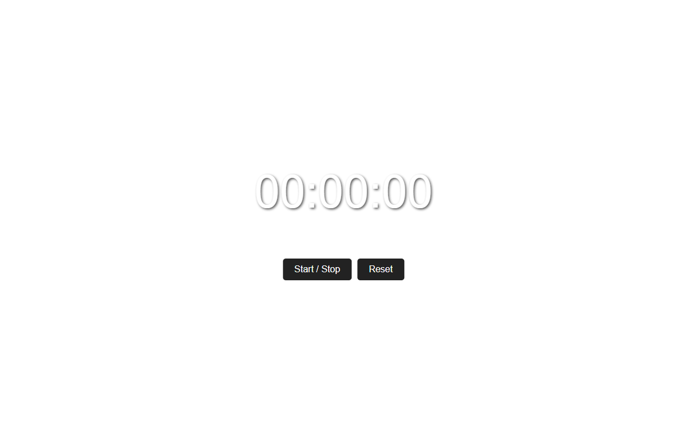
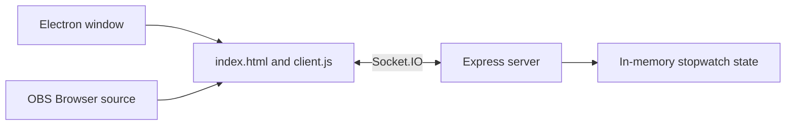

# OBS Work Timer Overlay

I wanted a work timer that could live on stream without becoming a second clock to manage. This small app shares one stopwatch between an OBS Browser source and an Electron window, with start/stop/reset controls and progress toward an eight-hour target. It’s local and in-memory by design; adapt the target or styling for your own scene, and send a PR if you improve the overlay.

*Click preview above to watch recorded interface demo.*

## Add it to an OBS scene

1. Clone or download this repo, install Node.js, then run `npm ci` and `npm start` from the project folder.
2. In OBS, add a **Browser** source and set the URL to `http://localhost:3000`. Size the source to fit your scene.
3. Use **Start / Stop** and **Reset** in the timer window or through **Interact** on the Browser source. All open views share the same timer state while the server runs.

To run the server without the Electron window, use `node server.js` after installing dependencies. The client has on-screen controls. The Electron build registers keyboard shortcuts, but the checked-in build does not wire their events through to the timer controls.

The server has no user login and the timer resets when its process restarts. Use it on a trusted local computer or network.

## Contributing

Questions and improvements are welcome in GitHub issues and pull requests.

## Interface preview

The capture shows the static interface at zero time; it does not show a running server or synchronized timer.

## How it is wired

The OBS browser source and Electron window connect to the same local Express/Socket.IO process, so they can display one running timer. There is no persistent timer database.
